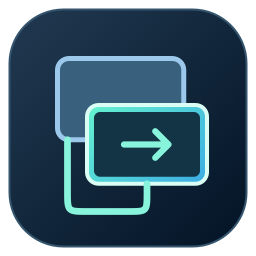

# WireDesk



**Your Mac. Your Windows second display. One Ethernet cable.**

WireDesk provides a native Mac receiver and Windows sender with an adaptive interface, protected pairing, saved setup and automatic reconnect. It is derived from [BetterCast by Stephen Lovino](https://github.com/StephenLovino/BetterCast), under GPL-3.0; original authorship and history are retained.

[Download releases](https://github.com/b0rdik/WireDesk/releases/latest) · [Setup and technical details](docs/ethernet-second-display.md) · [Updates](docs/updates.md) · [Validation](docs/validation/ethernet-results.md)

## Connect

1. Install WireDesk on both computers and join them with Ethernet. Mac creates its TLS identity automatically. An active Ethernet adapter appears without restarting; WireDesk selects it only when the choice is unambiguous.
2. Copy the Mac pairing code, or transfer its `.wiredesk-pair` file. Import it in WireDesk on Windows. Approve the first Windows connection on Mac.
3. Configure exactly one [Virtual Display Driver](https://github.com/VirtualDrivers/Virtual-Display-Driver) monitor with the driver’s official installer. Select **Extend**, select that monitor in WireDesk, and connect. WireDesk automatically applies the supported resolution/60 or 120 Hz, verifies the actual mode, and remembers the configuration.

Auto-connect is enabled by default for a saved pair and one available virtual monitor. After a transport interruption, the sender reconnects to the same wired interface and certificate. Stop explicitly to keep the session stopped. No silent fallback to Wi-Fi. Mac opens the received display; fullscreen can be exited with Escape.

On a direct cable, OS automatic IPv4 link-local addresses (`169.254.x.x`) normally work. Where automatic addressing is unavailable, configure a dedicated subnet without a gateway; the app links to network settings. Driver installation and privileged OS network changes remain explicit. Do not disable Secure Boot or the firewall.

## What is verified

The Mac release builds locally, TLS framing/rejection/reconnect and hardware H.264 decoding are tested, and pairing rejects malformed/ambiguous codes. GitHub Actions builds Mac universal and Windows x64 packages, runs relevant tests, and publishes signed feeds on version tags.

Physical Windows capture, a real VDD monitor, direct Ethernet throughput and 120 FPS scanout/end-to-end latency require a two-computer test. Display refresh support and received/decoded/newly submitted FPS are separate metrics. 120 FPS requires a supported hardware encoder; software fallback is restricted to 60 FPS.

## Build

Mac (Xcode/Swift, macOS 13+):

```sh
scripts/build-wiredesk-mac.sh dist/WireDesk.app
# Optional: WIREDESK_UNIVERSAL=1 scripts/build-wiredesk-mac.sh dist/WireDesk.app
```

Windows (MSVC, Qt 6 Core/Gui/Widgets/Network/OpenGLWidgets/Multimedia, FFmpeg with x264/NVENC/AMF/QSV):

```sh
cmake -S Sources/BetterCastReceiverDesktop -B build -G Ninja -DENABLE_SENDER=ON -DCMAKE_BUILD_TYPE=Release
cmake --build build
```

Use the complete Windows package with WinSparkle.dll for OTA updates. The installer registers pairing file/URL handlers and does not require administrator privileges. GPL source is provided in this repository and release source archives. Qt/FFmpeg/WinSparkle notices are bundled; see [acknowledgments](ACKNOWLEDGMENTS.md).

## Automatic updates

Sparkle 2.10.0 on Mac and WinSparkle 0.9.4 on Windows check HTTPS release feeds daily and verify Ed25519 archive signatures. Mac can download updates automatically; Windows prompts before installation. Updates cannot shut down an active streaming session. The first release is experimental (Mac ad-hoc/Windows unsigned); trusted OS distribution requires Developer ID/notarization and Authenticode credentials.

To release: update root `VERSION`, desktop `VERSION` and both Mac plist versions; commit and push `vX.Y.Z`. CI refuses mismatched versions or a missing signing secret. See [maintainer instructions](docs/updates.md).

Legacy BetterCast features remain accessible under **All features** and the desktop sidebar. Android/iOS targets retain their upstream identity and are not WireDesk OTA targets.
